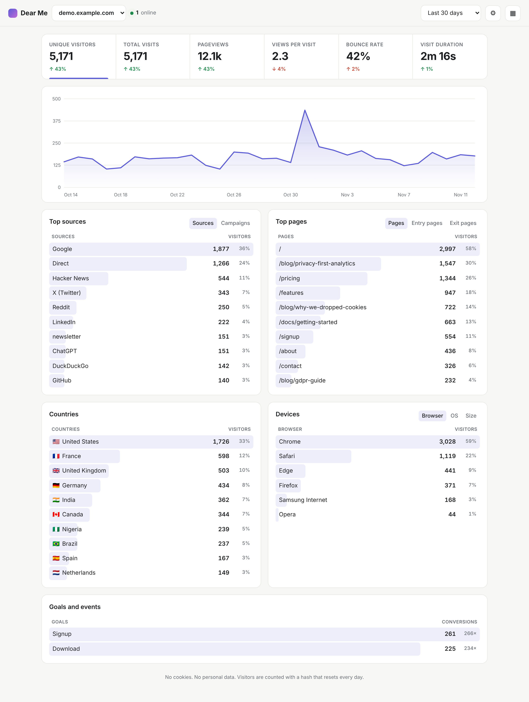

# Dear Me Analytics

Simple, private website analytics you own, with an analyst you can talk to. A cookie-free alternative to Google Analytics.



- **Ask your business anything.** "Where did my sales come from last month?", "Which ads are worth it?", "Why did visitors drop?". Answers in plain words with the numbers and a chart, from your website traffic, goals, sales and ad costs. Works out of the box; with an Anthropic API key, Claude reads the question and does the digging.
- **Alerts and next steps without asking.** Hourly checks flag tracking that stopped, traffic or sales that fell or jumped, a slipping conversion rate, ad campaigns spending without selling, and new sources. A ranked list of next steps says what each one is worth.
- **Sales and ad costs next to traffic.** Send revenue with a goal (`dearme('Purchase', { revenue: 49 })`), connect Stripe, Shopify or WooCommerce with one webhook address, or upload CSV exports from your shop and from Google, Meta, TikTok, LinkedIn or Microsoft Ads. See return on ad spend by channel and campaign.
- **One script tag**, 1.3 KB gzipped (Google Analytics is ~45 KB+). Does not slow your site.
- **No cookies, no personal data.** Visitors are counted with a hash that changes every day, so no cookie banner is needed for it in most cases. IP addresses are never stored.
- **Everything on one screen:** unique visitors, visits, pageviews, bounce rate, visit duration, live visitors, top pages, entry and exit pages, sources, UTM campaigns, countries, browsers, OS, device size, and goals (signups, purchases, downloads).
- **Click anything to filter.** Click "Google" to see only Google traffic across every report.
- **Live updates.** The dashboard refreshes the moment a visitor arrives.
- **Share a public dashboard** with a read-only link, and **export to CSV** any time.
- **Works with single-page apps** (React, Vue, Next.js) automatically.
- **Insights in plain English.** "Reddit sent 42 more visitors than last week." An optional AI summary (Claude) and a Monday email report for each site.
- **Funnels.** Home → Pricing → Signup: see where visitors drop off.
- **Teams.** Invite people as admins or read-only viewers.
- **Google Analytics import.** Upload GA4 or Universal Analytics CSV exports so your history comes with you.
- **Ready to sell.** Sign-up, separate customer accounts, Stripe subscriptions with a free trial, a landing page with pricing, and an operator admin panel.
- **Zero dependencies.** One Node process and one SQLite file. No Postgres, no ClickHouse, no Redis.

## Deploy in one command

### Render (one click)

[](https://render.com/deploy?repo=https://github.com/eaglepython/DearMe)

Click the button, sign in to Render, and press **Apply**. Render builds the Docker image, adds a 1 GB disk for your data, and generates an admin password (find it under **Environment** in the service). Your dashboard is live at `https://dear-me-analytics-xxxx.onrender.com` a few minutes later. This uses Render's Starter plan (about $7/month) because free instances have no persistent disk and would lose your stats on every deploy.

### Docker (any VPS, Synology, Raspberry Pi, your laptop)

```bash
docker compose up -d                       # uses ADMIN_PASSWORD from your shell, or "change-me"
# or
docker build -t dear-me . && docker run -d -p 3000:3000 -e ADMIN_PASSWORD=your-secret -v dearme:/data dear-me
```

Open `http://your-server:3000`, sign in, add your website, and paste the snippet it gives you into your site's `<head>`.

### Render, Railway, Fly.io, Coolify

Point the platform at this folder (or a GitHub repo containing it). It detects the Dockerfile. Set:

| Variable | Required | What it does |
|---|---|---|
| `ADMIN_PASSWORD` | yes | Your dashboard password |
| `DATA_DIR` | no (default `/data` in Docker) | Where the database lives. Mount a persistent disk here. |
| `RETENTION_DAYS` | no (default: keep forever) | Delete data older than this many days |
| `PORT` | no (default `3000`) | Port to listen on |

Attach a persistent volume at `/data` so stats survive redeploys.

### Plain Node (no Docker)

Requires Node 22.5 or newer. No `npm install` needed.

```bash
ADMIN_PASSWORD=your-secret node server.js
```

## Two ways to run it

**Just for your own sites.** Set `ADMIN_PASSWORD` and nothing else. Sign in at `/login` with that password (leave the email empty). Everything is unlimited.

**As a paid service for customers.** Set the Stripe variables below. The home page becomes a landing page with pricing, anyone can sign up for a 14-day free trial, and each customer only sees their own sites. You still sign in with `ADMIN_PASSWORD` and get an **Admin** page listing every account, its plan, usage and revenue.

### Selling it: Stripe setup (about 10 minutes)

1. In Stripe, create three products with monthly prices (suggested: Starter $9 for 10k pageviews, Growth $19 for 100k, Business $49 for 1M). Copy each price id (`price_...`).
2. Add a webhook endpoint `https://YOUR-DOMAIN/api/stripe/webhook` for the events `checkout.session.completed`, `customer.subscription.updated` and `customer.subscription.deleted`. Copy its signing secret (`whsec_...`).
3. In Stripe's Billing settings, turn on the customer portal so customers can change or cancel their plan.
4. Set the environment variables, then redeploy.

| Variable | What it does |
|---|---|
| `ADMIN_PASSWORD` | Operator password (required) |
| `PUBLIC_URL` | Your public address, e.g. `https://analytics.example.com`. Used in emails and Stripe redirects |
| `STRIPE_SECRET_KEY` | Turns on billing, plans, sign-up and the landing page |
| `STRIPE_WEBHOOK_SECRET` | Verifies Stripe webhooks |
| `STRIPE_PRICE_STARTER`, `STRIPE_PRICE_GROWTH`, `STRIPE_PRICE_BUSINESS` | Stripe price ids for each plan |
| `TRIAL_DAYS` | Free trial length (default 14) |
| `ALLOW_SIGNUP` | `true` or `false`. Defaults to on when billing is on |
| `SHOW_LANDING` | Show the landing page at `/` even without billing |
| `RESEND_API_KEY`, `REPORT_FROM` | Weekly email reports through [Resend](https://resend.com) (free tier: 3,000 emails a month). `REPORT_FROM` is e.g. `Dear Me <reports@yourdomain.com>` |
| `REPORT_HOUR_UTC` | Hour reports go out on Mondays (default 8) |
| `ANTHROPIC_API_KEY` | Adds an AI-written summary to insights and emails. Optional: plain-English insights work without it |
| `INSIGHTS_MODEL` | Claude model for the summary (default `claude-opus-5-5`) |
| `ANALYST_MODEL` | Claude model that answers questions when `ANTHROPIC_API_KEY` is set (default `claude-opus-5-5`). Without a key, a built-in parser answers common questions |
| `ANALYST_EFFORT` | How hard Claude thinks per question: `low` (default, fast), `medium` or `high` |
| `ANALYST_DAILY_LIMIT` | AI answers per customer account per day before falling back to built-in answers (default 200), to keep API costs predictable |
| `DATA_DIR`, `RETENTION_DAYS`, `PORT` | Storage folder, how long raw events are kept, and port |

Plan limits: sites over their monthly pageviews keep being counted up to 150% of the limit, and expired trials get a 3-day grace period, so nobody loses data the moment they cross a line.

## Add it to a website

```html
<script defer data-domain="example.com" src="https://stats.your-domain.com/script.js"></script>
```

Track goals:

```html
<script>window.dearme = window.dearme || function () { (dearme.q = dearme.q || []).push(arguments) }</script>
<button onclick="dearme('Signup', { plan: 'pro' })">Sign up</button>
```

Options on the script tag: `data-outbound` counts clicks on links to other sites. To exclude your own visits, run `localStorage.dearme_ignore = 'true'` in your browser console on your site.

Campaign links work out of the box: `?utm_source=newsletter&utm_campaign=launch`.

## Connect sales and ad costs

Sales, from whichever is easiest:

- **From your site:** `dearme('Purchase', { revenue: 49.99, order_id: 'A1001' })` on the thank-you page. The sale is credited to the visitor's source, campaign and landing page, without cookies.
- **From your shop:** in Settings, copy the site's webhook address and add it to Stripe (events `checkout.session.completed`, `invoice.paid`, `charge.refunded`), Shopify (Order payment, JSON) or WooCommerce (Order updated). Any other system can `POST` JSON: `{"amount": 49.99, "id": "A1001", "source": "google", "campaign": "spring"}` or `{"orders": [...], "ad_spend": [{"day": "2026-11-10", "channel": "Google", "campaign": "brand", "spend": 25}]}`.
- **From a file:** upload an orders CSV with a date and an amount column.

When the same order id arrives from the site and from the shop, it is counted once.

Ad costs: export a report by day from Google Ads, Meta Ads Manager, TikTok, LinkedIn or Microsoft Ads and upload it in Settings. Sales count toward an ad channel when the visit was tagged as paid (`utm_medium=cpc`, `paid_social`, or any `utm_campaign`); tag your ad links so return on ad spend is exact.

## Try it with demo data

```bash
npm run demo        # adds 90 days of traffic, sales and 60 days of Google and Meta ad costs for demo.example.com
npm start
```

## Run the tests

```bash
npm test
```

## How privacy works

For each pageview the server computes `sha256(daily_salt + site + ip + user_agent)` and keeps only the first 16 characters. The salt is random, changes every day, and the old one is deleted, so the same person can't be linked across days and the IP can't be recovered. Country comes from your CDN's country header (Cloudflare, Vercel, Fly) when present, otherwise from the browser's time zone. Bots, crawlers and headless browsers are filtered out.

## Put it behind HTTPS

Any reverse proxy works. With Caddy:

```
stats.your-domain.com {
  reverse_proxy localhost:3000
}
```

## Project layout

```
server.js          the whole backend: tracking endpoint, stats API, auth, static files
lib/ua.js          browser / OS detection and bot filter
lib/geo.js         time zone to country map
lib/billing.js     plans, limits and Stripe (REST, no SDK)
lib/funnels.js     funnel steps and counting
lib/insights.js    week-over-week facts, plain-English bullets, AI summary
lib/mailer.js      weekly email report (Resend)
lib/importer.js    Google Analytics CSV import
lib/business.js    sales and ad spend: webhooks (Stripe, Shopify, WooCommerce, JSON), CSV parsing, storage
lib/analyst.js     the analyst: metrics engine, plain-language questions, explanations, next steps, Claude tools
lib/alerts.js      hourly checks that raise alerts (and email urgent ones)
public/landing.html  marketing page with pricing
public/script.js   the tracker your websites load
public/            the dashboard (plain HTML, CSS, JS, no build step)
scripts/demo-data.js  fills the database with sample traffic
test/              end-to-end tests
```
